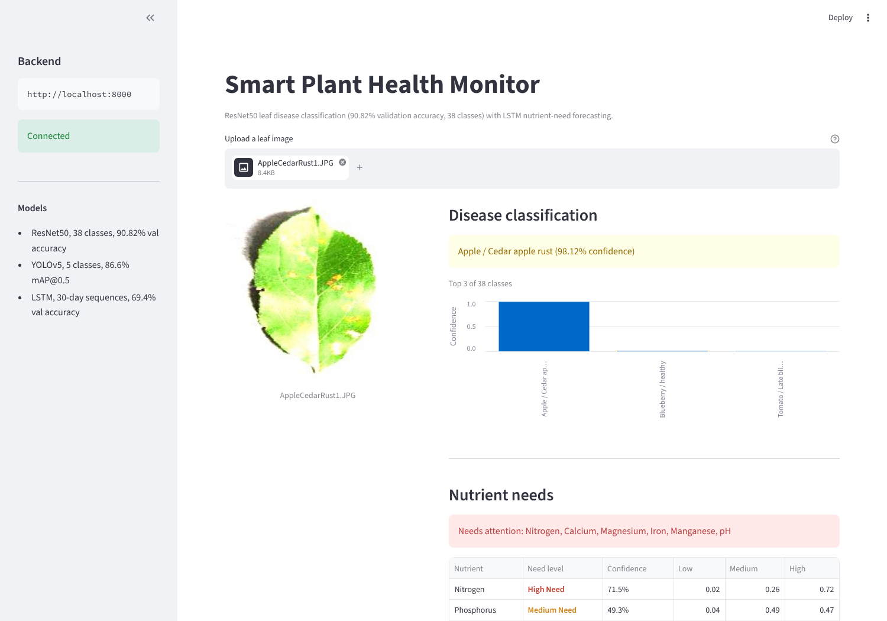

# Smart Plant Health Monitor

Classifies plant disease from a leaf image and forecasts nutrient needs from
sensor time series. ResNet50 reaches **90.82% validation accuracy across 38
classes**; a YOLOv5 detector localises affected regions, and an LSTM predicts
nutrient requirements from 30-day sensor sequences.

Built for DATA602 at the University of Maryland.

---

## Results

| Task | Model | Metric | Result |
| --- | --- | --- | --- |
| Disease classification | ResNet50 (ImageNet init, 38-class head) | Best val accuracy | **90.82%** |
| Leaf / lesion detection | YOLOv5 (5 classes) | mAP@0.5 | **86.6%** |
| Nutrient-need forecasting | LSTM (2 layers, 128 hidden) | Val accuracy | **69.4%** |

ResNet was trained for 25 epochs; final-epoch validation accuracy was 89.38%
with a best checkpoint at 90.82%. Per-epoch loss and accuracy curves are in
`models/resnet/training_history.json` and `models/lstm/training_history.json`.
YOLO training curves, confusion matrix and validation batches are under
`models/yolo/plant_disease/`.

The LSTM at 69.4% is the weak component. It trains on synthetically generated
sensor sequences, which is the honest limitation of that part of the system.

---

## How it works

```
leaf image ──► YOLOv5 detection ──► crop
                                      │
                                      ▼
                             ResNet50 classifier ──► disease (38 classes)

sensor history (30 days × 11 features) ──► LSTM ──► nutrient need per nutrient
                                                      (low / medium / high)
```

Both paths are served by a FastAPI backend and surfaced through a Streamlit UI.

### Endpoints

| Method | Path | Purpose |
| --- | --- | --- |
| GET | `/` | API metadata and model summary |
| GET | `/health` | Health check |
| POST | `/predict` | Disease classification from an uploaded image |
| POST | `/nutrition` | Nutrient-need predictions |
| POST | `/analyze` | Both, in one call |

---

## Dataset

[New Plant Diseases Dataset](https://www.kaggle.com/datasets/vipoooool/new-plant-diseases-dataset)
— roughly 87,000 RGB leaf images across 38 healthy and diseased classes.
Images are resized to 256, centre-cropped to 224 and normalised with ImageNet
statistics.

Sensor data for the LSTM is generated synthetically by
`src/data_preparation/generate_timeseries.py`.

---

## Setup

### 1. Install

```bash
git clone https://github.com/dhruvdubey3123/plant_health_monitor.git
cd plant_health_monitor

python -m venv venv
source venv/bin/activate          # Windows: .\venv\Scripts\Activate.ps1

pip install -r requirements.txt
```

### 2. Weights and processed metadata

All trained weights and metadata are committed, so the API runs straight
after `pip install`. The clone is roughly 130MB because of the checkpoints.

| File | Size | Contents |
| --- | --- | --- |
| `models/resnet/best.pth` | 90MB | ResNet50, 38-class head, 90.82% val accuracy |
| `models/yolo/plant_disease/weights/best.pt` | 28MB | YOLOv5, 5 classes, 86.6% mAP@0.5 |
| `models/lstm/best.pth` | 0.8MB | 2-layer LSTM, 69.4% val accuracy |
| `data/processed/resnet/class_mapping.json` | 1KB | class name to index for all 38 classes |
| `data/processed/lstm/metadata.json` | <1KB | sequence length, feature count, nutrient list |

To retrain rather than use the committed weights:
`python src/data_preparation/prepare_resnet_data.py` then
`python src/models/train_resnet.py`.

### 3. Train (only if regenerating weights)

```bash
python src/data_preparation/prepare_resnet_data.py
python src/models/train_resnet.py

python src/data_preparation/prepare_yolo_data.py
python src/models/train_yolo.py

python src/data_preparation/generate_timeseries.py
python src/models/train_lstm.py
```

Hyperparameters live in `config/config.yaml`: batch size 32, 50 max epochs,
learning rate 1e-3, early-stopping patience 10.

### 4. Run

```bash
# Terminal 1 — API on :8000
python src/api/main.py

# Terminal 2 — UI on :8501
streamlit run src/ui/app.py
```

Then open http://localhost:8501.



### Docker

```bash
docker compose -f docker/docker-compose.yml up --build
```

Weights and processed metadata are mounted from the host rather than baked
into the image, so step 2 still applies.

---

## Repository layout

```text
plant_health_monitor/
├── config/config.yaml              # paths, model and training hyperparameters
├── src/
│   ├── data_preparation/           # dataset exploration, ResNet/YOLO prep, sensor generation
│   ├── models/                     # train_resnet.py, train_yolo.py, train_lstm.py
│   ├── api/                        # FastAPI app (main.py) and inference (inference.py)
│   └── ui/app.py                   # Streamlit frontend
├── models/                         # trained weights and training histories
├── docker/                         # Dockerfile and docker-compose.yml
├── docs/                           # figures
└── requirements.txt
```

---

## Applying this to overhead imagery

The pipeline is a two-stage detect-then-classify design, which is the same
shape used for aerial and satellite work. Moving it to overhead imagery means
changing the data, not the architecture:

- **Tiling.** Satellite scenes are far larger than the 224px crops here, so
  input becomes fixed-size tiles with overlap, and predictions are stitched
  back to geographic coordinates.
- **Channels.** The ResNet stem takes 3-channel RGB. Multispectral input needs
  a widened first convolution, with ImageNet weights averaged or repeated
  across the new channels.
- **Class imbalance.** The 38 leaf classes are roughly balanced; overhead
  targets usually are not, which shifts evaluation toward per-class recall and
  precision-recall area rather than plain accuracy.
- **Label scarcity.** Leaf datasets are large and public. Overhead labelling
  is the expensive part, which pushes toward pretrained backbones and careful
  validation splits that respect geography rather than random splits.

What transfers unchanged is the training and evaluation scaffolding: the
detection-then-classification split, the checkpointing and history logging in
`src/models/`, and the inference-service pattern in `src/api/`.

---

## Limitations

- The LSTM trains on synthetic sensor data, so its 69.4% accuracy does not
  represent performance on real field sensors.
- The `/nutrition` endpoint generates a mock sequence when none is supplied;
  real deployment needs sensor readings wired in.
- Validation splits are random rather than stratified by field or capture
  session, so the accuracy figure is likely optimistic relative to new
  growing conditions.

---

## Team

DATA602 group project, University of Maryland.

| Name | UID |
| --- | --- |
| Raj Prasad Ambavane | 121998644 |
| Dhruv Dubey | 122129887 |
| Vansh Pradeep Jain | 122082892 |
| Shantanu Ramavat | 121997708 |

This repository holds the model training, inference and service work in this
copy of the project. The group's shared repository is at
[vjain0812/DATA602_smartPlant_health](https://github.com/vjain0812/DATA602_smartPlant_health).

---

## License

Academic coursework. The dataset is covered by its own Kaggle licence.
